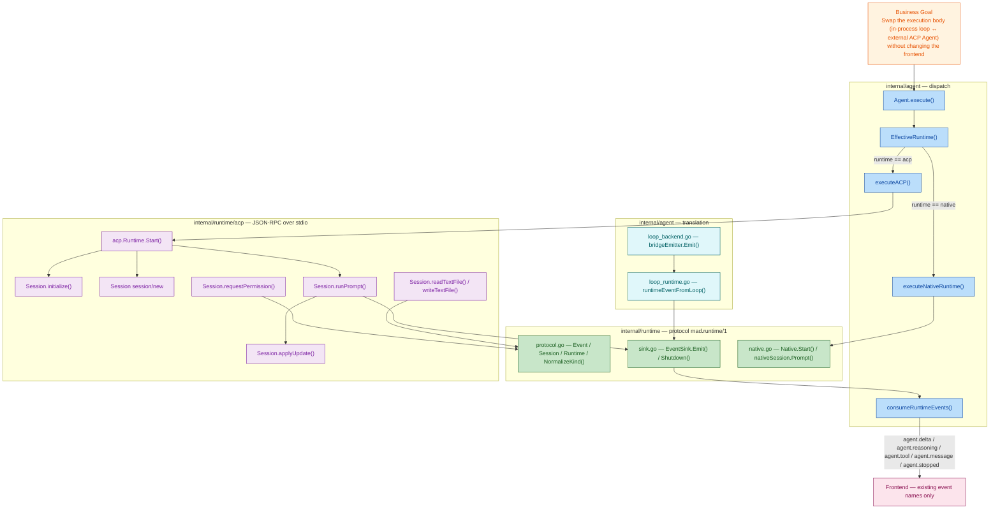
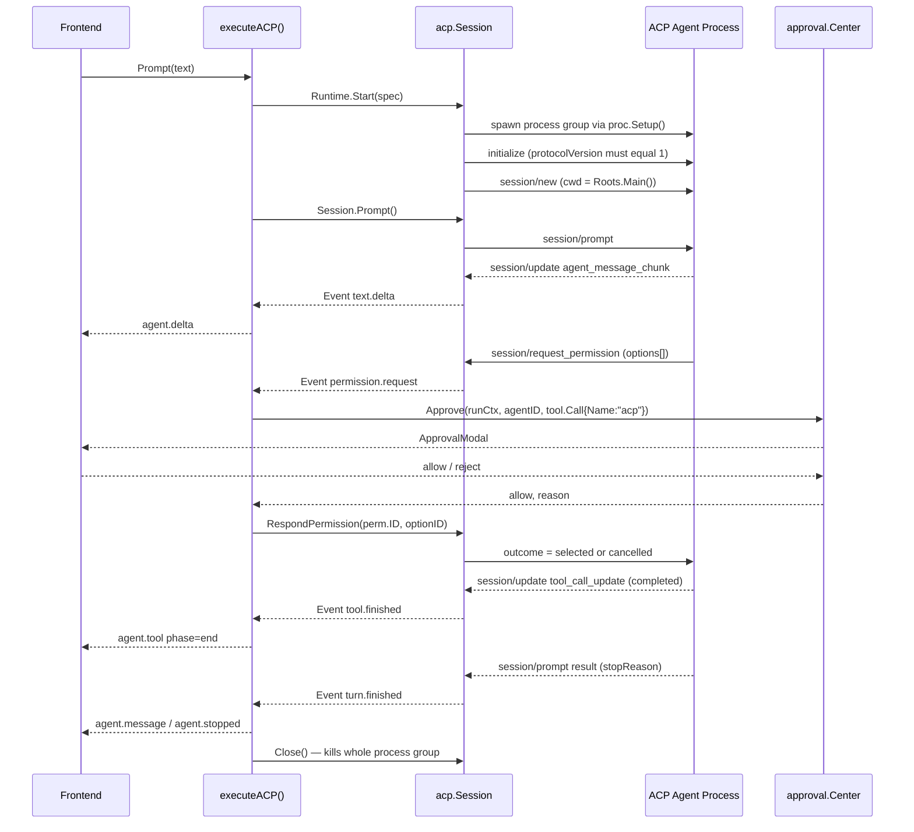
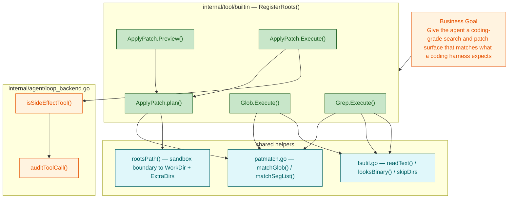
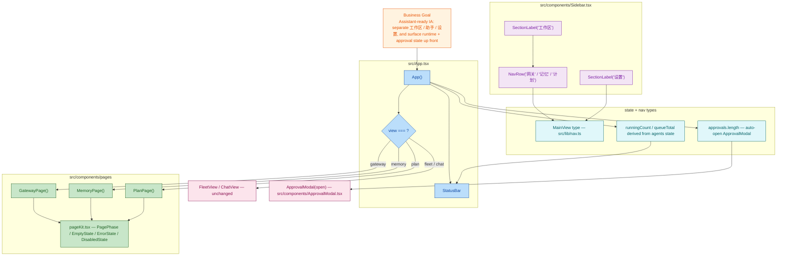

# Code Review Summary

## 1. High-Level Summary (TL;DR)

- **Impact: High** — This diff introduces a **new runtime execution layer** (`internal/runtime`, protocol `mad.runtime/1`) that unifies the in-process loop with external ACP Agents behind one event contract, adds **3 new builtin tools** (`grep`, `glob`, `apply_patch`), lands a **P0 security fix** for Feishu approval identity, and reshapes the **frontend information architecture** (status bar, nav groups, Gateway/Memory/Plan pages). 55 files touched, ~3,000 lines added.

- **Key Changes:**
  - ✨ **New unified runtime protocol** (`internal/runtime/protocol.go`, `sink.go`, `native.go`) — a versioned `Event`/`Session`/`Runtime` contract with a single-writer `EventSink` that owns `seq` allocation, provides blocking-send backpressure, and degrades unknown event kinds to `notice` instead of disconnecting.
  - ✨ **New ACP client** (`internal/runtime/acp/`) — JSON-RPC over stdio against any ACP-speaking agent (grok / codex-acp / dsh), with handshake, streaming updates, permission round-trip, `fs/*` reverse requests, process-group cleanup, and an optional raw-frame trace.
  - ✨ **Native loop rewired onto the protocol** (`internal/agent/loop_backend.go`, `loop_runtime.go`) — `loopEmitter` is replaced by `bridgeEmitter`; `runtimeEventFromLoop()` translates loop events into protocol events; both native and ACP now emit **only the pre-existing frontend events** (no new event types).
  - ✨ **3 new tools** (`grep`, `glob`, `apply_patch`) — pure-Go search (no shelling out to `rg`/`grep`), all-or-nothing batch patching with unique-anchor validation, and `apply_patch` added to the audit whitelist.
  - 🐛 **P0 security fix** — Feishu approval cards now verify `open_id` **before** consuming the pending card (`canApprove()`); strangers can no longer silently discard or decide an owner's approval.

---

## 2. Visual Overview (Code & Logic Map)

### 2.1 Runtime Abstraction — one protocol, two execution bodies



### 2.2 ACP Turn with Permission Bridge



### 2.3 New Tool Surface



### 2.4 Frontend Information Architecture (M1)



---

## 3. Detailed Change Analysis

### 3.1 `internal/runtime` — New Unified Protocol Layer

**What Changed:** A brand-new package defining the internal contract between the desktop app and whatever is executing a turn.

| Item | Detail |
|---|---|
| Protocol version | `mad.runtime/1` — add-only; unknown fields ignored; unknown kinds degraded via `NormalizeKind()` → `notice` + reason |
| Event kinds (12) | `turn.started`, `text.delta`, `thought.delta`, `tool.started`, `tool.updated`, `tool.finished`, `plan.updated`, `permission.request`, `notice`, `usage`, `turn.finished`, `error` |
| Event envelope | `v`, `seq` (int64, monotonic, sink-allocated), `sessionId` (**always the local agent id**, never the peer's `sessionId`), `turnId`, `kind`, `at`, `meta` |
| Session interface | `ID()`, `Prompt()`, `Cancel(turnID)`, `RespondPermission(requestID, optionID)`, `Events()`, `Close()` |
| Runtime interface | `Name()`, `Start(ctx, Spec) (Session, error)` |
| Sentinels | `ErrBusy`, `ErrClosed`, `ErrUnsupported` — adapters must return them verbatim |
| `Turn.Ask(ctx, Permission)` | Emits `permission.request`, then blocks until `RespondPermission` / ctx cancel |

**`EventSink` (`sink.go`) — the single exit for events:**
- `Begin()` / `End()` register producers; `Shutdown()` blocks new producers, closes `stop`, waits on the `WaitGroup`, then closes the channel — so consumers can `range` safely.
- `Emit()` is a **blocking send** → backpressure propagates into the ACP child's stdout pipe instead of growing an unbounded in-memory queue. Buffer default **512** (jitter absorption only, deliberately *not* a queue).
- `Emit()` stamps `v`/`seq`/`sessionId`/`at` — adapters must not number events themselves.

**`Native` adapter (`native.go`):**
- Wraps the in-process loop behind `ExecFunc(ctx, spec, turn, emit) (Stop, error)`.
- `Prompt()` returns **as soon as submission succeeds** (not when the turn ends) so the UI can still `Cancel` / `RespondPermission` mid-turn; a second concurrent `Prompt()` returns `ErrBusy`.
- `ask()` is fail-closed: with no `Approver` and no responder, the permission wait ends in `ErrClosed`/ctx error.
- `Close()` cancels the active turn, cancels the session ctx, and shuts the sink.

**Validation:** `Event.Validate()` enforces required fields per kind (e.g. `tool.started` needs `tool.id` **and** `tool.status`; `permission.request` needs `permission.id` **and** ≥1 option).

---

### 3.2 `internal/runtime/acp` — External Agent Client

**What Changed:** A full ACP (Agent Client Protocol) client speaking JSON-RPC 2.0 over stdio.

| ACP Method | Handling |
|---|---|
| `initialize` | Declares `protocolVersion: 1`, `fs.readTextFile/writeTextFile: true`, `auth.terminal: false`. **Any other version fails at startup.** 30s timeout; stderr tail appended to the error for diagnosis |
| `session/new` | `cwd` = primary root; `additionalDirectories` only sent if the peer advertises that capability |
| `session/prompt` | Content-block array; result `stopReason` → `rt.StopReason` |
| `session/cancel` | Notification, no reply awaited |
| `session/update` | Mapped to protocol events (see below) |

**`session/update` → protocol event mapping:**

| ACP `sessionUpdate` | Protocol event |
|---|---|
| `agent_message_chunk` | `text.delta` (+ accumulates `stop.finalText`) |
| `agent_thought_chunk` | `thought.delta` |
| `user_message_chunk` | ignored (local input already known) |
| `tool_call` | `tool.started` |
| `tool_call_update` (non-terminal) | `tool.updated` |
| `tool_call_update` (`completed`/`failed`/`cancelled`) | `tool.finished` |
| `plan` | `plan.updated` |
| `usage_update` | `usage` |
| `notice` | `notice` |
| anything else | ignored — **never disconnects on unknown peer updates** |

**Agent → Client reverse requests:**

| Method | Behaviour |
|---|---|
| `session/request_permission` | Emits `permission.request`, waits for `RespondPermission`, replies `{outcome:{outcome:"selected",optionId}}` or `cancelled` on timeout (default **5 min**) / close / cancel |
| `fs/read_text_file` | `Roots.Resolve()` → read; supports `line` / `limit` |
| `fs/write_text_file` | `Roots.Resolve()` → `MkdirAll` → write `0644` |
| `terminal/*` and everything else | `-32601 method not found` — **no shell surface is opened to the peer** |

**Transport & process hygiene (`transport.go`):**
- `Transport` interface (`WriteLine`/`ReadLine`/`Close`) lets tests run the exact protocol logic over an in-memory transport.
- `StreamTransport` uses `bufio.Reader.ReadBytes` (not `Scanner`) to avoid the 64 KB line cap; a hard **8 MB** frame limit guards against malformed peers.
- `Process` reads stdout **and** calls `Wait()` in the same goroutine (the `exec.Cmd` contract: `Wait` must not close pipes before stdout is drained, or the last frames are lost).
- `proc.Setup(cmd)` puts the child in its own **process group**; cancelling ctx kills the whole group so `node`/`git` grandchildren don't keep stdout open.
- Windows `.cmd`/`.bat` wrappers are launched via `cmd.exe /c` (`CreateProcess` cannot execute batch files directly).
- `tailBuffer` keeps only the last 8 KB of stderr for error messages.
- Optional `Trace` writer records every frame (in/out) as JSONL for replay.

**Process model decision:** one subprocess **per session** — crash isolation, credential isolation, and trivial event routing; the cost is memory/startup latency (documented as a future optimisation that keeps the `Session` interface unchanged).

---

### 3.3 `internal/agent` + Root Go — Backend Wiring

**What Changed:**

| File | Change |
|---|---|
| `internal/agent/manager.go` | New `Agent.Runtime` + `Agent.ACP` persisted fields; `runtimeState` / `runtimeError` (runtime-only, `json:"-"`); `Save`/`Load`/`Snapshot`/`viewMap` extended. **Dispatch order changed**: `EffectiveRuntime() == "acp"` **overrides** the backend, otherwise `loop` → `executeNativeRuntime()`, then `supervisor`/`doubao`/`mock` |
| `internal/agent/loop_backend.go` | `executeLoop()` is now a thin compatibility wrapper around `executeNativeRuntime()`. New `prepareNativeLoop()` does all pre-flight validation (model, workdir, `workdir.TooBroad`, registry, history isolation, checkpoint store) and returns an `rt.ExecFunc`. New `bridgeEmitter` replaces `loopEmitter` |
| `internal/agent/loop_runtime.go` | `runtimeEventFromLoop()` — the loop→protocol translator. Tool events carry `Call.ID`; when absent it degrades to `"<tool>#<iter>"` so start/end still pair |
| `internal/agent/runtime_backend.go` | `consumeRuntimeEvents()` — protocol → **legacy** frontend events. `handleRuntimePermission()` routes ACP permissions through `approval.Center`. `auditRuntimeTool()` / `auditToolCall()` rebuild a `tool.Call`/`tool.Result` for the audit log. `executeACP()` / `runACPSession()` drive the external path |
| `internal/agent/runtime_config.go` | `ACPConfig` type, `normalizeRuntime()` (accepts `""`/`native`/`loop` → `native`), `Manager.SetRuntime()`, `setRuntimeState()` (broadcasts `agent.config` on state change only) |
| `internal/loop/loop.go` | One-line but load-bearing: `tool.start` now carries `Call: &c` so tool-call IDs can be paired across start/end |
| `api_agent.go` | New `API.SetAgentRuntime(req)` — validates runtime value and non-empty ACP command, persists, broadcasts `agent.config` |
| `main.go` | `AgentView` gains `Runtime` / `ACP` / `RuntimeState` / `RuntimeError`; `viewRuntime()` normalises empty→`native`; `acpConfigFromMap()` rebuilds config from emitter payloads without panicking |
| `src/mygo.ts` | **Generated** — adds `ACPConfig`, `AgentRuntimeRequest`, `AgentView` fields, `API.setAgentRuntime()` |

**Protocol → frontend event mapping (no new event types):**

| Protocol event | Frontend event | Notes |
|---|---|---|
| `turn.started` | — | `execute` already emits `agent.status running` |
| `text.delta` | `agent.delta {id, delta, channelId}` | Also accumulates `a.Chars` |
| `thought.delta` | `agent.reasoning {id, reasoning}` | |
| `tool.started` | `agent.tool {phase:"start", content}` | Updates `a.LastTool` |
| `tool.finished` | `agent.tool {phase:"end", status, content}` | Content truncated to 400 chars |
| `permission.request` | `tool.approval` via `approval.Center` | Never auto-approved outside the Center |
| `notice` (severity=error) | `agent.error` | Other severities ignored |
| `error` | buffered, emitted once as `agent.error` | Avoids duplicate error surfaces |
| `turn.finished` | `agent.message` / `agent.stopped` / `agent.error` | Also writes back `runtimeState` |

**Tool-status preservation:** `rt.ToolStatus` only has 5 values, so the original loop status (`ok`/`error`/`denied`/`timeout`/`truncated`) is carried in `Meta["loopToolStatus"]` and read back by `runtimeToolStatusUI()`. ACP statuses collapse to `completed→ok`, `failed→error`, `cancelled→denied`.

**Permission option selection (`pickPermissionOption`)** — prefers `allow_once` → `allow_always` → any `allow_*`; reject path mirrors it; **empty string = cancelled** (the protocol's reject signal).

---

### 3.4 `internal/tool/builtin` — Three New Tools

**What Changed:** The registry grew from 4 to 7 tools (`RegisterRoots()` now also registers `Grep`, `Glob`, `ApplyPatch`).

#### `grep` — recursive content search
| Parameter | Type | Required | Description |
|---|---|---|---|
| `pattern` | string | ✅ | Literal substring by default; regex when `regex=true` |
| `path` | string | — | Root to search; defaults to `.` |
| `include` | string \| string[] | — | Glob filter for files to include |
| `exclude` | string \| string[] | — | Glob filter for files to exclude |
| `caseInsensitive` | boolean | — | Case-insensitive matching |
| `regex` | boolean | — | Treat `pattern` as a regular expression |
| `maxResults` | integer | — | Cap on hits (default **200**) |

- Output format is `path:line: text` (grep-style, so the model can cite locations).
- **Deliberately pure Go** — no shelling out to `rg`/`grep`/`git grep` (not guaranteed present on user machines, and shell escaping is an injection surface).
- Skips dependency/VCS dirs (`.git`, `node_modules`, `.venv`, `dist`, `build`, `target`, …) and binary files (NUL byte in the first 512 bytes).
- A single unreadable file is skipped rather than aborting the whole walk.

#### `glob` — filename pattern listing
| Parameter | Type | Required | Description |
|---|---|---|---|
| `pattern` | string | ✅ | e.g. `**/*.go` |
| `path` | string | — | Directory to search under |
| `maxResults` | integer | — | Cap (default **500**) |

- Supports `**` (zero or more segments), `*`, `?`.
- A pattern **without** `/` matches against the basename at any depth (`*.go` behaves as expected).
- Results are **lexicographically sorted** so repeated calls are reproducible.

#### `apply_patch` — batched file edits
| Field | Type | Required | Description |
|---|---|---|---|
| `patches[].path` | string | ✅ | File path (resolved against WorkDir + ExtraDirs) |
| `patches[].op` | `add` \| `update` \| `delete` | ✅ | Operation |
| `patches[].content` | string | for `add` | Full file content |
| `patches[].oldText` | string | for `update` | **Unique** context anchor |
| `patches[].newText` | string | for `update` | Replacement text |

**Safety model (the important part):**
- `plan()` performs **all** validation first — anchor must exist **exactly once** (ambiguity reports the occurrence count so the model can add context), `add` requires the file to not exist, `delete` requires it to exist, duplicate paths within one batch are rejected, and `oldText == newText` is a no-op error.
- `Preview()` and `Execute()` **share the same `plan()`**, so the diff shown in the approval card is literally what lands on disk.
- `Execute()` **re-runs `plan()`** before writing, so a file changed between preview and approval causes a rejection instead of a stale overwrite.
- `apply_patch` was added to `isSideEffectTool()` so it lands in the audit log with a `+N/-N` diffstat summary.

---

### 3.5 Frontend — M1 Information Architecture

**What Changed:**

| Component | Change |
|---|---|
| `src/lib/nav.ts` *(new)* | `MainView = 'fleet' \| 'chat' \| 'gateway' \| 'memory' \| 'plan'` — extracted from `App.tsx` so `Sidebar` and `App` share one type |
| `src/components/StatusBar.tsx` *(new)* | Top bar: Gateway badge (hard-coded **"未接入"** disabled state — no fabricated online/latency), running count, pending-approval count (clickable → opens the queue), queue depth. All values are computed from existing frontend state, never from invented backend data |
| `src/components/pages/pageKit.tsx` *(new)* | Shared shell for the three new pages: `PageHeader`, `PageBody`, `SkeletonRows`, `EmptyState`, `ErrorState`, `DisabledState`. Every button is explicitly `disabled` when the backend doesn't exist — the codebase's stated rule *"no buttons that look clickable but do nothing"* |
| `GatewayPage.tsx` / `MemoryPage.tsx` / `PlanPage.tsx` *(new)* | Placeholder pages fixed to the `disabled` phase, with `empty`/`loading`/`error` branches pre-wired so swapping in real data later needs no layout rewrite. `MemoryPage` exposes a **working** link to the existing knowledge inspector and explicitly distinguishes 记忆 from 知识库 |
| `src/components/Sidebar.tsx` | Sessions group moved to the top under a **工作区** section; new **助手** (Gateway/Memory/Plan) and **设置** sections with `NavRow` / `SectionLabel` components. The duplicate "运行 N" footer counter was removed (now in the StatusBar) |
| `src/App.tsx` | Shell switched to a column layout with the StatusBar on top; new view routing; `approvalOpen` state with auto-open whenever `approvals.length > 0` |
| `src/components/ApprovalModal.tsx` | New optional `open` prop (defaults `true`, preserving existing behaviour) |
| `src/components/MentionInput.tsx` | **TypeScript fix only** — `props` is actually a `Target`, not `MentionNodeAttrs`; also dropped the unused `escapeReg` helper |
| `src/styles/components.css` | New `.c-badge--disabled`, `.c-nav-row*`, `.c-skeleton` + `skeleton-pulse` keyframes, with a `prefers-reduced-motion` guard |

---

### 3.6 Feishu Approval Identity — P0 Security Fix

**What Changed:** Previously `decide()` consumed the pending approval card **before** checking who clicked it — any member of a group could silently discard the owner's card or approve on their behalf.

**Before → After:**

| Aspect | Before | After |
|---|---|---|
| Card consumption | `takeAsk()` happened unconditionally | `canApprove()` runs **first**; the card is only taken by an authorised identity |
| Identity source | `Sender` was never checked | `actionFromPayload()` parses `event.operator.open_id` (falling back to `user_id`) into `Turn.SenderID` / `Turn.SenderType` |
| Allow rule | anyone | `OwnerOpenID` **or** an entry in `ApproverOpenIDs` |
| Fail-closed | n/a | Missing `SenderID`, `SenderType` of `app`/`bot`, or an empty owner+whitelist ⇒ **reject** |
| User feedback | n/a | The card owner receives: *"只有会话 owner 或审批白名单里的人能处理这张卡。请让 owner 操作，或在设置里配置审批人。"* |
| Owner capture | n/a | `FinishFeishuUserAuth()` auto-writes the first authorising user's `open_id` as `OwnerOpenID` and persists it |
| Config reset | n/a | Changing `AppID` clears `OwnerOpenID` / `ApproverOpenIDs` — open_ids are namespaced per app |

**Persistence rules (`internal/config/config.go`):** empty `OwnerOpenID` / `ApproverOpenIDs` on save **inherit** the previous values (so a settings page that doesn't yet expose them won't wipe them).

---

### 3.7 Miscellaneous

- **`internal/llm/compact_test.go`** — assertion updated `4096 → 8192`, matching the actual default context window (resolves the known red-CI item).
- **`.gitignore`** — added `*.syso` (Windows resource artefacts).
- **Docs** — 3 new documents (`docs/runtime-protocol.md` 435 lines, `docs/runtime-api-contract.md` 227 lines, `docs/assistant-architecture.md` 298 lines) plus `docs/reviews/context-2026-11-25.md` (a handoff snapshot), and updates to `README.md` / `docs/design.md`.

---

## 4. Impact & Risk Assessment

### 4.1 Breaking / Behavioural Changes

| # | Change | Impact | Compatibility |
|---|---|---|---|
| 1 | `AgentView.runtime` is **always** non-empty (`"native"` \| `"acp"`) | Frontend consumers must not treat it as optional | Additive field; old clients ignore it |
| 2 | `AgentView` gains `acp`, `runtimeState`, `runtimeError` | New fields on every `AgentView` exit point | Additive |
| 3 | `agents.json` gains `runtime` + `acp` | Older `agents.json` loads as `native` | **No migration needed** — `normalizeRuntime("")` → `native` |
| 4 | `config.json` FeishuBot gains `ownerOpenId` + `approverOpenIds` | Existing users have neither | Additive |
| 5 | **Feishu approvals now fail closed** | Existing Feishu users who never completed user auth will have **all** approval cards rejected until an owner is captured | ⚠️ **Behavioural break** — needs a migration path / clearer UI copy |
| 6 | Tool registry **4 → 7** | More schema tokens per model request; `apply_patch` adds a new write surface | Model-visible change |
| 7 | `internal/loop` `tool.start` event now carries `Call` | Internal event shape change | Internal only |
| 8 | New MyGo API `API.setAgentRuntime` | Additive | `src/mygo.ts` must be regenerated, not hand-edited |

### 4.2 Risks & Findings

| Severity | Finding | Location | Recommendation |
|---|---|---|---|
| 🔴 **High** | **`segReCache` is an unsynchronised package-level map.** `matchSegment()` reads *and writes* it. Concurrent tool calls (multiple agents, parallel tool execution) can trigger Go's "concurrent map read and map write" fatal error. | `internal/tool/builtin/patmatch.go:68` | Replace with `sync.Map` or guard with a `sync.RWMutex`. `go test -race` will catch this — it must be run before merge. |
| 🔴 **High** | **ACP `fs/write_text_file` bypasses the approval center.** The external agent can write files directly through the reverse-request channel; only *path* sandboxing (`Roots.Resolve`) applies, not *whether* the write is approved. This contradicts the design rule "all tool calls must pass approval" (`docs/assistant-architecture.md` §6.6). | `internal/runtime/acp/client.go` → `writeTextFile()` | Route ACP writes through `approval.Center` (or at minimum emit an audit entry and honour `PermissionMode`). |
| 🟠 **Medium** | **Approval blocks the single event-consumer goroutine.** `consumeRuntimeEvents()` calls `handleRuntimePermission()` inline, which blocks on `approval.Center.Approve()`. While blocked, no further protocol events are consumed — including `turn.finished` — and the 512-frame sink buffer can fill, stalling the ACP producer. | `internal/agent/runtime_backend.go` → `consumeRuntimeEvents()` | Handle permissions in a dedicated goroutine (or a bounded permission queue) so the event loop keeps draining. |
| 🟠 **Medium** | **`apply_patch` batch writes are not atomic.** Validation is all-or-nothing, but the *write* loop is sequential: if entry 3 fails, entries 1–2 are already on disk while the tool returns `Fail`. The doc string's "整批拒绝、一个字节都不写" only holds for validation failures. | `internal/tool/builtin/apply_patch.go` → `Execute()` | Either back up + roll back on failure, or soften the doc/summary wording to "validation is atomic; writes are best-effort in order". |
| 🟠 **Medium** | **Truncation counter is always wrong.** `len(hits)-limit` is ≤ 0 because hits are already capped at `limit`, so the message reads "[0 more matches omitted]" or "[-3 more matches omitted]". | `internal/tool/builtin/grep.go:181`, `glob.go:133` | Track the true overflow count during the walk and report that. |
| 🟡 **Low** | **`EventSink.Emit()` burns a `seq` on validation failure** — `s.seq++` happens before `ev.Validate()`, leaving a hole in the sequence for clients that assume strict `+1`. | `internal/runtime/sink.go` → `Emit()` | Validate before allocating the sequence number. |
| 🟡 **Low** | **`agent.status` is no longer re-emitted per iteration.** The old `loopEmitter` emitted `agent.status running` on every `iter.start`; `runtimeEventFromLoop()` maps `iter.start` → `usage` only. The contract says `execute` emits it once — verify the UI still shows "running" for multi-iteration turns. | `internal/agent/loop_runtime.go`, `internal/agent/manager.go` | Confirm with a multi-iteration native turn. |
| 🟡 **Low** | **Typo in a new exported constant:** `PermissionRejectAlwa` (truncated "Always"). | `internal/runtime/protocol.go:83` | Rename now — renaming a public constant later is a breaking change for importers. |
| 🟡 **Low** | **Checkpoint load now ignores the run context:** `store.Load(runCtx, runID)` → `store.Load(context.Background(), runID)`. Intentional (avoids a cancelled-ctx load failure), but a stale checkpoint can now be resumed into a turn that is already being cancelled. | `internal/agent/loop_backend.go` | Confirm no cancelled-turn resume is possible. |
| 🟡 **Low** | **`runtimeState` / `runtimeError` are not persisted** (`json:"-"`) by design and reset to `""` after restart. | `internal/agent/manager.go` | Frontend must treat `""` as "never started", not "offline". |
| 🟡 **Low** | **Layout regression risk:** `c-shell` switched to `flexDirection: 'column'` with a new inner flex wrapper; the sidebar's session group moved from bottom to top. | `src/App.tsx`, `src/components/Sidebar.tsx` | Visual regression check in light + dark themes. |

### 4.3 Testing Suggestions

**Build & unit**
```bash
go build ./...
go test ./internal/runtime/... ./internal/tool/... ./internal/agent/... ./internal/feishu/... -count=1
go test -race ./internal/tool/builtin/...          # REQUIRED — catches the segReCache race
npx mygo generate && git diff --stat src/mygo.ts   # confirm src/mygo.ts is generated, not hand-edited
npm run typecheck && npm run build:web
```

**Scenario matrix**

| Area | Scenarios |
|---|---|
| 🧪 Runtime | Normal turn; second `Prompt` while busy → `ErrBusy`; `Cancel("")` mid-turn; `Cancel(wrongTurnID)` → no-op; `Close()` → events channel closes; unknown event kind → degraded to `notice`; `Validate()` rejects malformed events |
| 🧪 ACP | Handshake success; `protocolVersion != 1` → startup failure; streaming text + thoughts; tool start/update/finish; plan + usage updates; permission allow / reject / timeout (5 min); cancel mid-turn; **process exits unexpectedly** → `notice` + `error` + `turn.finished(error)`; unknown `session/update` → ignored, no disconnect; `fs/read_text_file` + `fs/write_text_file`; `terminal/*` → `-32601` |
| 🧪 ACP security | Attempt a write outside `WorkDir` / `ExtraDirs` → must be rejected by `Roots.Resolve`; attempt a symlink escape |
| 🧪 Native regression | Multi-iteration turn; budget exhaustion → `StopBudget`; user stop → `StopCancelled`; channel turn isolation (no private history leaking into a group turn); checkpoint resume |
| 🧪 Event mapping | Protocol → legacy events produce identical shapes for native and ACP; `loopToolStatus` preserves `denied`/`truncated`/`timeout` in the tool-end card; `agent.error` is emitted exactly once per failure |
| 🧪 Permissions | ACP permission routed through `approval.Center`; allow → `allow_once`; reject → `reject_once`; timeout / cancel / close → empty optionID ⇒ peer receives `cancelled`; **`auto` mode must not be widened by the adapter**; `readonly` always rejects |
| 🧪 Tools | `grep`: literal vs regex, case-insensitive, include/exclude, binary skip, dependency-dir skip, result cap; `glob`: `**`, basename-only patterns, sorting, cap, no-match; `apply_patch`: multi-file batch success, stale anchor, ambiguous anchor (count reported), `add` on an existing file, `delete` of a missing file, duplicate path in one batch, `Preview` writes nothing and its diff matches the executed diff, approver denial, **partial-write failure** |
| 🧪 Feishu | Stranger clicks → card **not consumed** and **not decided**; whitelist member decides; owner decides; **no owner + no whitelist → fail closed**; `AppID` change clears approver config; owner auto-captured on first user auth |
| 🧪 Frontend | Status bar counts update live; approval queue opens from the badge and auto-opens on new approvals; all 5 nav destinations render; all three new pages show the correct 4 states (empty/loading/error/disabled) with **no dead buttons**; light + dark themes; e2e covers the empty states |
| 🧪 Persistence | Legacy `agents.json` (no `runtime`) → loads as `native`; switching to `native` **preserves** the `acp` config; `args`/`env` blank entries are stripped; ACP config is deep-copied (no shared slice mutation) |

**Manual smoke**
```bash
go run ./cmd/acp-probe -cmd <agent> -arg acp -cwd . -prompt "列出目录" -trace /tmp/acp.jsonl
go run ./cmd/acp-probe -cmd <agent> -cwd . -allow      # exercise the permission path
```

---

### 4.4 Reviewer Checklist (Suggested)

- [ ] Confirm `src/mygo.ts` was produced by the generator and matches the Go structs byte-for-byte.
- [ ] Confirm the `segReCache` race is fixed before merge (blocking).
- [ ] Decide whether ACP `fs/write_text_file` must go through `approval.Center` (blocking for the security story).
- [ ] Decide the Feishu approval migration path for existing users (currently fail-closed with no owner).
- [ ] Verify `npm run build:web` and `go build ./...` are green on Windows **and** CI (macOS/Linux).
- [ ] Confirm `go test -race` passes on CI (`CGO_ENABLED=1` required on Windows).
- [ ] Reconcile `docs/runtime-protocol.md` §9 ("本轮没有动现有执行路径") with the actual code — the native path **has** now been migrated onto `rt.Native`.