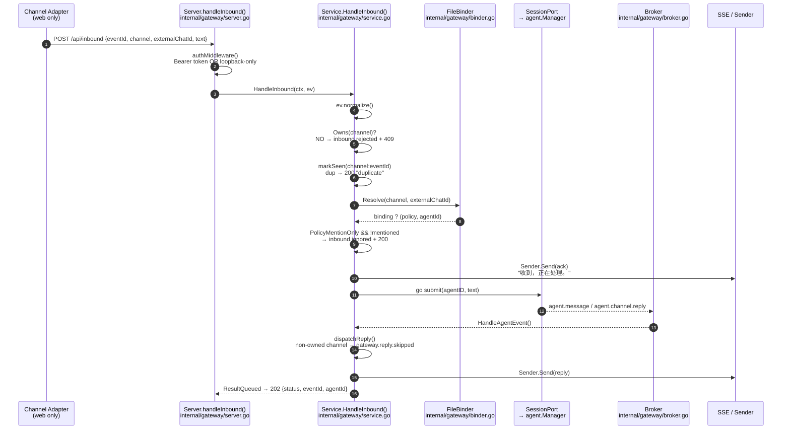
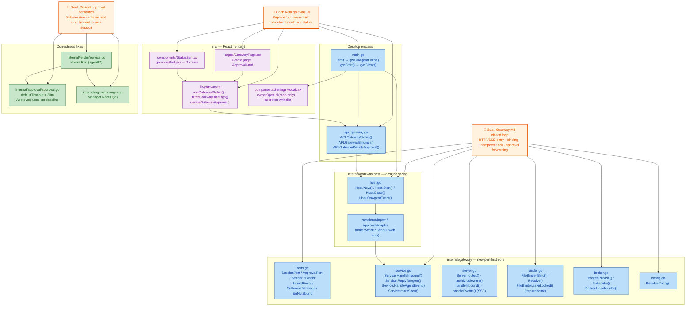

# Code Review Summary — Embedded Gateway (M3) + Supporting Packages

> **2026-11-26 复核更新（收工存档）**
> - 本文是网关 M3 评审时点的快照；其中「memory / scheduler 尚未接进进程」已过时：两者已接入桌面主进程，现状以 `docs/memory-and-scheduler.md` 和 `docs/reviews/status-2026-11-26.md` 为准。
> - §4.1 的 **#1（Broker send-on-closed panic）** 与 **#2（main.go 的 gw 读写竞态）** 在收工时仍未修复，属于下一轮优先项；#3–#7 也仍是待处理项。
> - 全量验证结果见 `docs/reviews/status-2026-11-26.md`：Playwright 133 passed；Go 全量仅 `internal/shellguard` 的既有 Windows `find / -delete` 用例外失败。

## 1. High-Level Summary (TL;DR)

* **Impact:** **High** — This is the "M3 gateway closed loop" milestone. A brand-new `internal/gateway` package (HTTP + SSE server, channel routing, binding store, event bus) is wired into the desktop process, replacing the previous hard-coded "gateway not connected" placeholder in the UI with a live, data-backed page. Two adjacent correctness fixes (approval timeout, sub-session Feishu approval cards) and two new-but-unwired packages (`internal/memory`, `internal/scheduler`) ride along.

### Key Changes

* ✨ **New `internal/gateway` package** — ports-first design (`SessionPort` / `ApprovalPort` / `Sender` / `Binder`) with a stdlib-only HTTP+SSE server, no third-party router or auth library.
* ✨ **Desktop embedding via `internal/gateway/host`** — `main.go` starts `127.0.0.1:8780` on boot, bridges every agent event into the gateway bus, and closes the gateway *before* `Manager.Shutdown()`. Listen failure is **non-fatal** (desktop keeps running, UI shows the reason).
* ✨ **Gateway page rewritten from placeholder to real** — 4 states (loading / error / disabled / active), live overview, binding list, agent list, and inline approval decisions (allow-once / allow-for-session / deny-with-reason).
* 🐛 **Approval wait now follows the session's `ctx` deadline** — default raised 5 min → 30 min; a fixed 5-minute cap was killing the last step of long Supervisor turns. Timeout still **denies**, never auto-allows.
* 🐛 **Feishu sub-session approval cards now attach to the root session's run** — previously silently dropped because a child session has no Feishu run.
* 📦 **Two new packages, not yet wired to the process**: `internal/memory` (SQLite FTS5, Chinese trigram search) and `internal/scheduler` (interval/cron-lite heartbeat, quiet windows, token-bucket rate limits, exponential backoff). Adds `modernc.org/sqlite` (pure Go, no cgo).

> ⚠️ **Scope note:** the diff spans 5 parallel workstreams (gateway, memory/scheduler, approval/Feishu fixes, frontend, docs) merged without cross-cutting conflicts — see `docs/reviews/final-acceptance-2026-11-25.md` for the intended ownership split.

---

## 2. Visual Overview (Code & Logic Map)

### 2.1 Inbound message flow — the core new logic

### 2.2 Business Goal ↔ Module/File ↔ Key Methods

---

## 3. Detailed Change Analysis

### 3.1 🌐 `internal/gateway` — New Port-First Gateway Core

**What changed:** A brand-new package implementing the channel layer. It depends **only downward through interfaces** — it never imports `internal/agent`, `internal/runtime`, or the desktop `Manager`. Unwired ports return explicit `NOT_WIRED` errors rather than fabricating sessions or approvals.

**Port interfaces (Source: `internal/gateway/ports.go`)**

| Port | Method(s) | Real implementation wired by `host` |
|---|---|---|
| `SessionPort` | `Prompt()`, `Stop()`, `Status()`, `List()` | `agent.Manager` via `sessionAdapter` |
| `ApprovalPort` | `Pending()`, `Decide(id, allow, remember, reason)` | `approval.Center` via `approvalAdapter` |
| `Sender` | `Send(ctx, OutboundMessage)` | `brokerSender` (publishes `gateway.outbound` on the SSE bus) |
| `Binder` | `Bind()`, `Resolve()`, `List()`, `Unbind()` | `FileBinder` → `<dataDir>/gateway-bindings.json` |

**Constants and sentinels (Source: `internal/gateway/ports.go`)**

| Constant / Error | Value | Meaning |
|---|---|---|
| `ChannelFeishu` / `ChannelTelegram` / `ChannelWeb` | `feishu` / `telegram` / `web` | Channel identifiers; **only `web` is owned by default** |
| `PolicyMentionOnly` / `PolicyAllowAll` | `mentionOnly` / `allowAll` | Reply policy; empty policy normalises to `allowAll` |
| `OutboundAck` / `OutboundReply` / `OutboundNotice` | `ack` / `reply` / `notice` | Outbound message kinds |
| `ErrNotBound` | — | Chat not bound to a local agent → HTTP 422 |
| `ErrNotWired` | — | Port not connected → HTTP 503 |
| `ErrDuplicate` | — | Event ID already processed |
| `ErrChannelNotOwned` | — | Channel not owned by this gateway → HTTP 409 |

**HTTP/SSE API surface (Source: `internal/gateway/server.go`)** — stdlib `http.ServeMux` only, no third-party routing or auth library.

| Method | Path | Success | Depends on |
|---|---|---|---|
| `POST` | `/api/inbound` | `202` queued / `200` duplicate·ignored | Binder, Session, Sender |
| `GET` | `/api/status` | `200` snapshot | all (optional) |
| `GET` | `/api/agents` | `200` list | SessionPort |
| `GET` | `/api/approvals` | `200` list | ApprovalPort |
| `POST` | `/api/approvals/{id}` | `200 {"ok":true,"id":…}` | ApprovalPort |
| `GET` | `/api/bindings` | `200` list | Binder |
| `GET` | `/api/events` | `text/event-stream` | Broker |

**Error envelope & codes (Source: `internal/gateway/server.go`)**

| HTTP | `error.code` | Trigger |
|---|---|---|
| 400 | `INVALID_BODY` | Body is not valid JSON |
| 400 | `INVALID_EVENT` | Missing `eventId` / `channel` / `externalChatId` |
| 400 | `APPROVAL_DECIDE_FAILED` | Approval already resolved / session gone |
| 401 | `UNAUTHORIZED` | Missing/wrong Bearer token, or non-loopback without token |
| 409 | `CHANNEL_NOT_OWNED` | Channel not in the owned set (e.g. `feishu`) |
| 422 | `NOT_BOUND` | Chat not bound to an agent |
| 503 | `NOT_WIRED` | Port not wired to the real kernel |
| 500 | `STREAM_UNSUPPORTED` / `INTERNAL` | No flusher / internal failure |

**Inbound processing order** (Source: `internal/gateway/service.go` — `HandleInbound()`), which mirrors `docs/assistant-gateway-api.md` §4 exactly:

1. `normalize()` — trim all fields; default `kind="message"`.
2. **Channel ownership first** — a non-owned channel is rejected *before* dedupe/binding/ack/submit, so it consumes no dedupe slot and produces no side effects (`inbound.rejected`).
3. **Dedupe** on `channel + ":" + eventId` — in-memory LRU-ish ring of 1024 entries (`markSeen()`).
4. **Binding resolution** — unresolved ⇒ `inbound.unbound` + `ErrNotBound`.
5. **Policy filter** — `mentionOnly` + not mentioned + not `system` ⇒ `ignored`.
6. **Immediate ack** via `Sender` — sent **before** returning; ack failure does **not** block the submission (error goes to the event stream).
7. **Async submit** — `go s.submit(agentID, text)` → `SessionPort.Prompt`. Errors land in `inbound.error`.

**Channel-ownership filter (a deliberate anti-duplicate-reply design):**

| Scenario | Inbound | Outbound reply |
|---|---|---|
| Bound to `web` (owned) | processed | sent via `Sender` |
| Bound to `feishu` (not owned) | `409 CHANNEL_NOT_OWNED` | `gateway.reply.skipped` — `Sender` is **never** called, so the desktop's existing `feishu.Hub` stays the single sender |
| Bound to `telegram` (not owned) | `409 CHANNEL_NOT_OWNED` | `gateway.reply.skipped` |

**Persistence (Source: `internal/gateway/binder.go`)** — `FileBinder` writes `<dataDir>/gateway-bindings.json` using **tmp-file + `os.Rename`** atomic replace (`saveLocked()`), file mode `0o600`, data dir `0o755`. Binding key uses `\x00` as the channel/chat separator so IDs cannot collide. `List()` sorts by `channel` then `externalChatId` for stable ordering across restarts.

**Event bus (Source: `internal/gateway/broker.go`)** — in-process pub/sub; 32-buffered subscriber channels; monotonically increasing `seq`; **non-blocking publish** (a slow subscriber never blocks the emitter). SSE sends a `gateway.connected` frame on connect and a `: ping` comment every 15 s.

### 3.2 🖥️ `internal/gateway/host` + `main.go` — Desktop Embedding

**What changed:** `internal/gateway/host` maps the gateway's port interfaces onto the real kernel and owns the HTTP listener.

| Host concern | Implementation | Notes |
|---|---|---|
| Session wiring | `sessionAdapter` → `agent.PromptRequest{AgentID, Text}` | `agentToStatus()` maps `agent.Agent.Snapshot()` → `gateway.SessionStatus` |
| Approval wiring | `approvalAdapter` → `approval.View` | Field-for-field copy |
| Sender | `brokerSender` | **Rejects any channel ≠ `web`** with `ErrChannelNotOwned`; otherwise publishes `gateway.outbound` |
| Listener lifecycle | `Host.Start(addr, token)` / `Host.Close(ctx)` | `Close` is idempotent; 3 s shutdown timeout in `main.go` |
| Failure policy | `Start` returns error, Host stays queryable | `ListenError` recorded, `Running=false`, desktop keeps running |

**`main.go` wiring (Source: `main.go`)**

| Concern | Change |
|---|---|
| Struct | `API` gains `gw *gwhost.Host` |
| Event bridge | The shared `emit` closure now calls `gw.OnAgentEvent(event, data)` for **every** agent event, before the MyGo emit |
| Startup | `gwhost.New(Deps{Manager: mgr, Approvals: mgr.Approvals(), DataDir: dataDir})`; failure ⇒ `gw = nil` + log, desktop continues |
| Address | `MAD_GATEWAY_ADDR`, default `127.0.0.1:8780`; token from `MAD_GATEWAY_TOKEN` |
| Shutdown | `gw.Close(ctx)` **before** `mgr.Shutdown()` — stop accepting inbound, then stop the kernel |
| Feishu | `feishu.Hooks` gains `Root: func(id) { return api.mgr.RootID(id) }` |

### 3.3 🔌 `api_gateway.go` — IPC View Layer (nil-safe)

**What changed:** Three new MyGo-bound methods that mirror gateway state into the frontend.

| Method | Returns | `gw == nil` behaviour |
|---|---|---|
| `API.GatewayStatus()` | `GatewayStatusView` — process status + `wired` map + channels + uptime + counts + agent/approval **lists** | `gateway:false`, all slices `make(...)` (**never `null`**), `Wired` empty map, all counts `0` |
| `API.GatewayBindings()` | `[]GatewayBindingView` | empty (non-nil) slice |
| `API.GatewayDecideApproval(id, allow, remember, reason)` | `error` | `"网关未启用"` error — never a fake success |

Covered by `api_gateway_test.go` (`TestGatewayStatusNilHost`, `TestGatewayBindingsNilHost`, `TestGatewayDecideApprovalNilHost`).

### 3.4 🖥️ Frontend — From Placeholder to Live Page

| File | What changed |
|---|---|
| `src/lib/gateway.ts` *(new)* | Thin IPC adapter: typed-method-first with a `call('API.GatewayStatus')` fallback for stale binaries; `normalizeStatus/Agent/Approval/Binding` guard against `null`/`undefined` from the bridge; `useGatewayStatus(pollMs)` hook with mount-refresh + interval + cleanup; `formatUptime()`; `GATEWAY_DISABLED` constant |
| `src/components/pages/GatewayPage.tsx` | **Rewritten** from a static "未接入" placeholder to a 4-state page: `loading` skeleton → `error` + retry → `unavailable`/`!gateway` empty state → active dashboard with overview (addr, uptime, SSE subscribers, owned channels, 4 wired-port badges), binding list, agent list, and approval cards. Approval card supports **允许一次 / 本会话允许 / 拒绝(+原因)** with per-card error display. The `phase` prop was removed. |
| `src/components/StatusBar.tsx` | Gateway badge is no longer hard-coded "未接入" — now `gatewayBadge()` returns **运行中 / 端口占用 / 已停止 / 未启用** with tooltips |
| `src/App.tsx` | `useGatewayStatus(6000)` feeds only the status bar; detail pages re-fetch their own data |
| `src/components/SettingsModal.tsx` | Feishu **approval owner open_id** (read-only input) + **approver whitelist** textarea (one open_id per line) |
| `src/mygo.ts` *(generated)* | New `GatewayAgentView` / `GatewayApprovalView` / `GatewayBindingView` / `GatewayStatusView` types + three `API.gateway*` methods |
| `src/styles/components.css` | `.c-settings__textarea` style (min-height, vertical resize, mono font) |

**Settings → `API.SaveFeishu` payload changes (Source: `src/components/SettingsModal.tsx`)**

| Field | Type | Rule |
|---|---|---|
| `ownerOpenId` | `string \| undefined` | Read-only in UI, sourced from `FeishuView.ownerOpenId`; `undefined` when blank (keeps the stored value) |
| `approverOpenIds` | `string[] \| undefined` | One open_id per line → trimmed → blanks dropped → de-duplicated (first occurrence order preserved); `undefined` when empty ⇒ keep saved value |

### 3.5 🐛 Correctness Fixes

**Approval timeout (Source: `internal/approval/approval.go`)**

| Aspect | Before | After |
|---|---|---|
| Default wait | fixed `5 * time.Minute` | `defaultTimeout = 30 * time.Minute` |
| Wait derivation | always the fixed cap | `ctx.Deadline()` remaining time if present, else the default cap |
| On expiry | reject | reject — **never auto-allow** (unchanged fail-closed guarantee) |
| On `ctx.Done()` | reject `"这一轮已停止，审批取消"` | unchanged, and now fires at the session deadline rather than waiting out the cap |

> Rationale (from the source comment): the 5-minute cap was *shorter* than a Supervisor turn (10 min), so the final approval of a long task was mis-detected as "waiting for approval timed out".

**Sub-session Feishu approval cards (Source: `internal/feishu/service.go` + `internal/agent/manager.go`)**

| Aspect | Before | After |
|---|---|---|
| Card target | `cur.agent == v.AgentID` | `cur.agent == Root(v.AgentID)` — resolved through `Hooks.Root` |
| Root lookup | — | `Manager.RootID(id)` walks `ParentID` upward, max 32 hops, cycle-safe (returns the current ID on cycle/missing) |
| Failure mode | child session has no Feishu run ⇒ card **silently dropped** | card attaches to the root session's run |
| `Hooks.Root == nil` | — | falls back to the original ID (backwards compatible) |

### 3.6 📦 New Packages (Not Yet Wired to the Process)

**`internal/memory` — SQLite FTS5 structured memory** (Source: `internal/memory/store.go`, `models.go`, `search.go`)

Uses `modernc.org/sqlite` (pure Go, **no cgo**). Schema is created with `IF NOT EXISTS` and is idempotent.

| Object | Columns | Natural key / constraint |
|---|---|---|
| `events` | `id, kind, source, agent_id, content, created_at, meta` | append-only; `meta` defaults to `"{}"` |
| `notes` | `id, title, body, tags, source, created_at, updated_at` | `UNIQUE(source, title)` → `UpsertNote` overwrites body/tags, refreshes `updated_at` |
| `facts` | `id, subject, predicate, object, confidence, source_event_id, created_at` | `UNIQUE(subject, predicate, object)` → `PutFact` refreshes confidence + provenance; FK `→ events(id) ON DELETE SET NULL` |
| `notes_fts` / `facts_fts` / `events_fts` | FTS5 virtual tables | `tokenize='trigram'` for Chinese; sync triggers keep them in step |
| Indexes | `idx_events_created`, `idx_notes_updated`, `idx_facts_subject` | Descending time order |

| Setting | Value |
|---|---|
| DSN pragmas | `journal_mode(WAL)`, `foreign_keys(ON)`, `busy_timeout(5000)`, `synchronous(NORMAL)` |
| Connection pool | `SetMaxOpenConns(1)` — `foreign_keys` is a connection-level pragma |
| Search strategy | `ftsPhrase(query)` (quoted, `"` doubled) **OR** `LIKE %q%` with `ESCAPE '\'` and escaped `% _ \` — the LIKE path catches sub-trigram (short) queries |
| Empty query | Returns most-recent rows (no error); `limit <= 0` → 20 (notes/facts) or 50 (events) |
| Testability | `open(path, now func() time.Time)` injects a fixed clock |

**`internal/scheduler` — heartbeat scheduler** (Source: `internal/scheduler/scheduler.go`, `schedule.go`)

| Feature | Detail |
|---|---|
| Triggers | `interval` (fixed period) and `cron` (5-field cron-lite: `*`, `*/n`, single integer) |
| Cron semantics | Vixie-compatible: dom **OR** dow when both are restricted, otherwise **AND**; `7` → `0` for Sunday |
| Quiet window | `QuietWindow{StartHour, StartMinute, EndHour, EndMinute, Loc}`; cross-midnight supported (`22:00–08:00`); `Loc == nil` → `time.Local` |
| Rate limiting | Lazily-refilled token bucket, capacity = `maxPerHour`, refill rate = `maxPerHour/3600` per second; one global + one per task; `0` = unlimited |
| Backoff | `base * 2^(failures-1)`, capped; success resets the counter and clears `backoffUntil` |
| Scheduling | `Tick(ctx)` returns a `Result` per task in registration order with a `Reason` (`not-due` / `quiet` / `global-limit` / `task-limit` / `backoff`) |
| Injectability | `Clock` interface (`RealClock` / fake clock) and `Runner` interface — the package never sends messages itself |

**Dependency change (Source: `go.mod`)**

| Package | Old Ver | New Ver | Note |
|---|---|---|---|
| `modernc.org/sqlite` | — | `v1.63.0` | **New direct dependency** — pure Go SQLite driver (no cgo) |
| `github.com/dustin/go-humanize` | — | `v1.1.0` | indirect (SQLite driver) |
| `github.com/google/uuid` | — | `v1.6.0` | indirect |
| `github.com/mattn/go-isatty` | — | `v0.0.24` | indirect |
| `github.com/ncruces/go-strftime` | — | `v1.1.0` | indirect |
| `github.com/remyoudompheng/bigfft` | — | `v0.0.0-…` | indirect |
| `golang.org/x/sys` | — | `v0.49.0` | indirect |
| `golang.org/x/text` | — | `v0.43.0` | indirect |
| `modernc.org/libc` | — | `v1.80.1` | indirect |
| `modernc.org/mathutil` | — | `v1.7.1` | indirect |
| `modernc.org/memory` | — | `v1.12.1` | indirect |

> ⚠️ `modernc.org/sqlite` noticeably increases first-build time and binary size — already flagged in `docs/reviews/final-acceptance-2026-11-25.md` §5.

### 3.7 📄 Docs & Test Coverage

**Documentation**

| File | Change |
|---|---|
| `docs/assistant-gateway-api.md` *(new)* | Full HTTP/SSE contract for the **embedded** form: boundary rules, error-code table, endpoint table, inbound ordering, SSE event catalogue, persistence, env vars, and an explicit "not in this milestone" list |
| `docs/assistant-architecture.md` | Rewritten topology: gateway becomes a **library** embedded in the desktop; Feishu stays on `feishu.Hub` (single long connection, no duplicate replies); M3.5 (standalone daemon) deferred; §10 decisions marked as settled |
| `docs/runtime-api-contract.md` | §8 changed from "frontend to-do" to "implemented" with file-level landing points |
| `docs/reviews/code-review-2026-11-25.md`, `docs/reviews/final-acceptance-2026-11-25.md` *(new)* | Audit checklists, pass criteria, file-ownership split, deferred scope, risk register |
| `README.md` | Directory map, layer table, and "current limitations" updated (gateway embedded; memory/scheduler **packages only**) |

**Tests added**

| Area | Coverage |
|---|---|
| `internal/gateway/service_test.go` | Full loop (inbound→bind→ack→submit→reply), dedupe, unbound, approval forwarding, broker delivery, `NOT_WIRED`, `mentionOnly`, default-`web`-only rejection, explicit multi-channel, `gateway.reply.skipped`, web reply delivery |
| `internal/gateway/server_test.go` | Token 401 matrix, loopback-only (incl. `::1`), inbound HTTP codes (202/200/422/400), approvals HTTP, `NOT_WIRED` 503, status snapshot, `CHANNEL_NOT_OWNED` 409 |
| `internal/gateway/host/host_test.go` | Session/approval field mapping, channel filtering, **port-in-use degradation**, `Close` idempotency, binder file path |
| `api_gateway_test.go` | `gw == nil` nil-safety for all three IPC methods |
| `internal/memory/store_test.go` | CRUD, **Chinese search**, note/fact upsert idempotency, migration idempotency, empty query, fixed clock |
| `internal/scheduler/scheduler_test.go` | Quiet window then run, per-task & global rate limits, backoff then recover, cron across midnight, quiet-window timezone boundary, pure backoff, invalid cron |
| `internal/approval/approval_test.go` | Default timeout > 10 min, approval follows `ctx` deadline, long session survives the default cap, user stop rejects |
| `internal/agent/manager_test.go`, `internal/feishu/service_test.go` | `RootID` parent walk; sub-session approval card lands on the root run |
| `e2e/gateway.spec.ts` *(new)* | 5 Playwright cases: active dashboard, allow-once, deny-with-reason, port-in-use, disabled |
| `e2e/feishu-whitelist.spec.ts` *(new)* | 2 cases: owner read-only + whitelist dedupe, backend error passthrough |
| `e2e/runtime.spec.ts` *(new)* | 6 cases for native/ACP runtime selection and badges |
| `e2e/mock-runtime.ts` | Extended with gateway mocks (3 modes), `SetAgentRuntime`, Feishu whitelist echo, `feishuError` injection |

---

## 4. Impact & Risk Assessment

### 4.1 ⚠️ Issues Found in This Diff

| # | Severity | Location | Issue |
|---|---|---|---|
| 1 | 🔴 **High** | `internal/gateway/broker.go` — `Publish()` / `Unsubscribe()` | **Send-on-closed-channel panic.** `Publish` snapshots subscriber channels under the lock, then releases it and sends. `Unsubscribe` removes the map entry under the lock, releases it, then `close(ch)`. A publish racing a client disconnect can send on a closed channel and **panic the whole desktop process**. Fix: hold the lock across the send, or use a `done` channel / `sync.Once` + recover, or never close subscriber channels (rely on `ctx.Done()`). |
| 2 | 🟠 **Medium-High** | `main.go` — `var gw *gwhost.Host` + the `emit` closure | **Data race.** The emitter closure reads `gw` from the enclosing scope, but `gw` is assigned (`gw, gwErr = gwhost.New(...)`) later on the main goroutine, after the agent manager's workers already exist. Unsynchronised read/write — will be flagged by `-race`. Fix: assign `gw` before starting the manager, or use `atomic.Pointer[gwhost.Host]`. |
| 3 | 🟠 **Medium** | `internal/gateway/service.go` — `HandleInbound()` ordering | **Dedupe burns the event before the wiring check.** `markSeen()` runs before the `Session == nil` check, so an inbound event that arrives while the session port is unwired is permanently marked as seen; a later retry returns `duplicate` and the message is **silently lost**. Consider marking "seen" only after a successful hand-off, or reserving a separate "in-flight" set. |
| 4 | 🟠 **Medium** | `internal/gateway/host/host.go` — `Host.Start()` | **`listenErr` is never cleared on success.** `Start` sets `h.listenErr` on failure but does not reset it. A retry after a failed start (allowed, since `running` stays `false`) succeeds at listening but the UI keeps showing "端口占用". Also, a runtime `Serve` failure sets the same field, so the badge label "端口占用" may describe a non-bind error. |
| 5 | 🟠 **Medium** | `internal/scheduler/scheduler.go` — `run()` | **Global token leak.** The global token is consumed *before* the per-task token; if the task limit is exhausted, the global token has already been burned. Also `limiter.consume()` mutates state **outside** `s.mu` (the lock is taken only afterwards), inconsistent with `evaluate()` which holds it — a latent race if `Tick` is ever called concurrently. |
| 6 | 🟡 **Low-Medium** | `internal/gateway/service.go` — policy filter | `ev.Kind == "system"` bypasses the `mentionOnly` gate, and `kind` comes from the **untrusted** request body. Any client that can reach `/api/inbound` can set `"kind":"system"` to skip the mention requirement. Derive "system" from a trusted source, or drop the exemption. |
| 7 | 🟡 **Low-Medium** | `internal/memory/store.go` — `PutFact()` | `ON CONFLICT ... source_event_id = excluded.source_event_id` sets the column to `NULL` when the new fact carries no source event — **silently erasing the provenance link** of an existing fact. Use `COALESCE(excluded.source_event_id, facts.source_event_id)`. |
| 8 | 🟡 **Low** | `internal/gateway/broker.go` — `Publish()` comment | The comment says slow subscribers "丢最旧的后续事件" (drop the *oldest*), but the `select`/`default` branch actually drops the **newest** event. Fix the comment or the behaviour. |
| 9 | 🟡 **Low** | `internal/scheduler/schedule.go` — `NextCron()` | Minute-by-minute scan up to 366 days (≈527 k iterations, up to ~2 M for a Feb-29 spec), invoked from `nextSchedule()` **while holding `s.mu`**. Consider a coarser scan step or computing the next match field-by-field. |
| 10 | 🟡 **Low** | `internal/gateway/config.go` — `DefaultDataDir()` | Defaults to `~/.multi-agent-desktop/gateway`, but `docs/assistant-gateway-api.md` §8 explicitly states this directory is **no longer used**. Only `cmd/mad-gateway` reaches this path — align the default or the doc. |
| 11 | 🟡 **Low** | `internal/gateway/server.go` — `secureEqual()` | Returns early on a length mismatch, leaking the token length. Acceptable for a local self-use token (and the source comment says so), but `crypto/subtle.ConstantTimeCompare` is a one-liner. |
| 12 | 🟡 **Low** | `src/components/pages/GatewayPage.tsx` | `useEffect` depends on `[status.gateway, status.bindings]` — bindings only re-fetch when the **count** changes; an edit that keeps the count stale leaves the list stale. |
| 13 | ⚪ **Info** | `main.go` | The new code uses `strings.TrimSpace` and `context.WithTimeout`/`context.Background()` — confirm `strings` and `context` are already imported by `main.go` (not visible in this diff hunk). |
| 14 | ⚪ **Info** | `src/mygo.ts` | Generated artifact — the acceptance checklist requires it to come from `npx mygo generate` only, never hand-edited. Verify the diff matches the generator output. |

### 4.2 Breaking Changes

| Area | Change | Impact |
|---|---|---|
| **HTTP API (new)** | `POST /api/inbound`, `GET /api/status`, `GET /api/agents`, `GET /api/approvals`, `POST /api/approvals/{id}`, `GET /api/bindings`, `GET /api/events` | New surface; no existing consumers to break |
| **HTTP semantics** | Non-owned channels now return `409 CHANNEL_NOT_OWNED` | New endpoints — but clients must handle 409 (documented) |
| **MyGo IPC** | `API.GatewayStatus()`, `API.GatewayBindings()`, `API.GatewayDecideApproval()` | Additive; older binaries fall back to raw `call()` routing |
| **Approval timeout** | Default `5 min` → `30 min`, and wait now follows `ctx.Deadline()` | **Behavioural change:** an unattended approval card now stays pending up to 30 min instead of 5. Fail-closed is preserved (expiry still denies) |
| **Feishu `Hooks` struct** | New optional `Root func(agentID) string` field | Source-compatible; `nil` ⇒ old behaviour |
| **React `GatewayPage`** | `phase?: PagePhase` prop **removed** | Any caller still passing `phase` will fail to compile/typecheck |
| **`StatusBar`** | New optional `gateway?: GatewaySummary` prop | Additive, defaults to "未启用" |
| **Database** | New SQLite file (`memory` package) | New file only — **no migration of existing `knowledge` JSONL**; the two stores remain separate by design |
| **Files on disk** | New `<dataDir>/gateway-bindings.json` | New file in the desktop data dir, alongside `agents.json` |
| **No schema migrations** | — | `internal/gateway` persistence is JSON, `internal/memory` is a fresh SQLite DB — **no existing database schema is altered** |

### 4.3 Testing Suggestions

**Gateway core**
- ✅ Re-run `go test ./internal/gateway/... -count=1` after the broker fix; add a **stress test** that publishes concurrently with `Unsubscribe` (run under `-race` on macOS/Linux — Windows CI lacks cgo).
- Verify **duplicate-after-failure** semantics: send an inbound event while the session port is unwired, then wire it and retry with the same `eventId` — confirm whether the message is lost (see finding #3) and decide the intended behaviour.
- Verify the **`kind:"system"` bypass** is intentional (finding #6) and add a test that pins the chosen behaviour.
- Verify **`Host.Start` retry** after a bind failure clears `listenError` and flips the badge to "运行中" (finding #4).
- Verify **`listenErr` labelling** when `Serve` fails for a non-bind reason — the badge currently always says "端口占用".

**Approval / Feishu**
- ✅ Long-running task (>10 min) with a write tool: confirm the final approval card is **not** killed by a fixed timeout, and that a user stop still denies immediately.
- ✅ Nested sub-session (child → mid → root): confirm the card appears on the **root** conversation and the decision reaches the correct `approval.Center` entry.
- ✅ Cycle safety: a self-referential `ParentID` must terminate `RootID` within the 32-hop cap.
- ✅ A stranger clicking a Feishu card must still be rejected (existing `TestApprovalStrangerCannotConsumeOrDecide`).

**Scheduler / Memory**
- ✅ `Tick()` under `-race` with a slow `Runner` to expose the unlocked `limiter.consume` mutation (finding #5).
- ✅ Verify the global token is **not** consumed when a task is blocked by its own per-task limit.
- ✅ Cron across midnight, DST boundary, and `dow`/`dom` OR-semantics.
- ✅ Chinese search: 2-character queries (below trigram width) must still hit via the `LIKE` fallback; verify `%`/`_`/`\` in a query are escaped, not treated as wildcards.
- ✅ Verify `PutFact` **preserves** `source_event_id` when re-putting a fact without provenance (finding #7).
- ✅ `Migrate()` run twice against the same file — must be a no-op.

**Frontend / E2E**
- ✅ `npx playwright test` — the gateway spec's `getByText('web', {exact:true})` may become ambiguous if the binding list grows; consider a `data-testid`.
- ✅ Poll the gateway page for >5 min and confirm the approval list does not **duplicate** cards (the page re-polls every 5 s while `GatewayStatus` returns the live pending list).
- ✅ Simulate an IPC failure mid-poll and confirm the page keeps the last good data and surfaces the error rather than blanking.
- ✅ Verify `npm run typecheck` and `npm run build:web` pass with the `GatewayPage` prop removal.

**Integration / acceptance**
- ✅ Run the full checklist from `docs/reviews/final-acceptance-2026-11-25.md` §1 (`go build ./...`, `go vet`, all `go test` packages, `npm run typecheck`, `npm run build:web`, `npx playwright test`).
- ✅ On a real desktop run, confirm `/api/status` reports `wired: {session, approval, sender, binder}` all `true` and that a `web` inbound event round-trips into an agent reply.
- ✅ Confirm the desktop starts **normally** when `127.0.0.1:8780` is already occupied, and that the gateway page shows the bind error.
- ✅ Confirm shutdown ordering: no inbound is accepted after `gw.Close()`, and no agent reply is lost between gateway close and `Manager.Shutdown()`.

---

### 5. Verdict

**Architecture: strong.** The port-first gateway (`internal/gateway` knows nothing about `internal/agent`), the fail-closed approval semantics, the "never fabricate data" rule (`NOT_WIRED` instead of fake sessions), and the explicit anti-duplicate-reply design for Feishu are all well-reasoned and consistently applied across code, tests, and docs.

**Before merging, address findings #1 (broker panic) and #2 (`main.go` data race)** — both can take down the whole desktop process, and both are cheap to fix. Findings #3–#7 are correctness/UX issues worth resolving in this round; the remainder can be follow-ups.